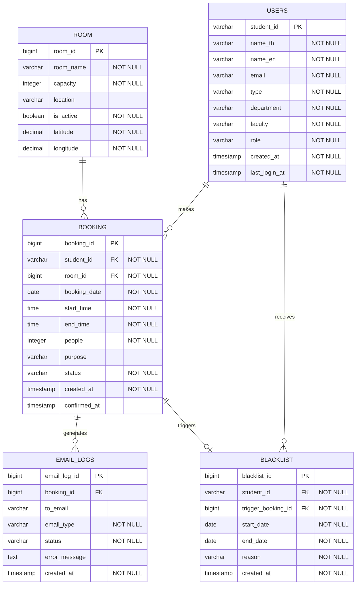

# Database ER Diagram

## Sprint 2 – US8, US9, US10

> **Note:**  เดิมใช้  * เพื่อแทน NOT NULL แต่ Mermaid ไม่รองรับ * ใน ER Diagram เลยเปลี่ยนเป็น "NOT NULL" แทน

## Table Descriptions

### USERS

เก็บข้อมูลผู้ใช้งานระบบ

- `role` ระบุสิทธิ์ของผู้ใช้งาน เช่น `student` / `admin`
- `type` ระบุประเภทผู้ใช้งาน เช่น `student` / `employee`

### ROOM

เก็บข้อมูลห้อง โดย `latitude` และ `longitude` ใช้เป็น **พิกัดอ้างอิงของ Coworking Space** สำหรับตรวจสอบตำแหน่งขณะ Check-in (US8) เนื่องจากห้องที่เปิดให้จองทั้งหมดอยู่ภายใน Coworking Space เดียวกัน ผู้ใช้ต้องอยู่ภายในระยะ **5 เมตร** จากพิกัดอ้างอิงดังกล่าว

### BOOKING

เก็บข้อมูลการจอง โดยใช้ `confirmed_at` สำหรับบันทึกเวลาที่ Check-in สำเร็จ และ `status = 'EXPIRED'` สำหรับรายการ No-show (US8, US9)

สถานะของ Booking มีดังนี้:

| Status | ความหมาย |
| -------- | -------- |
| `BOOKED` | สร้าง Booking แล้ว แต่ยังไม่ Confirm |
| `CONFIRMED` | Check-in สำเร็จ |
| `CANCELLED` | ยกเลิก Booking |
| `EXPIRED` | ไม่ Confirm ภายในเวลาที่กำหนด / No-show |

**Constraint:** `end_time <= 16:00` (Task 64)

### EMAIL_LOGS

เก็บประวัติการส่งอีเมลของระบบ เช่น อีเมลยืนยันหรืออัปเดต Booking และอีเมลแจ้งเตือนการระงับสิทธิ์

`email_type` มีดังนี้:

| Email Type | ความหมาย |
| -------- | -------- |
| `BOOKING_CONFIRMED` | อีเมลยืนยันการจอง |
| `BOOKING_UPDATED` | อีเมลแจ้งการเปลี่ยนแปลง Booking |
| `ACCOUNT_SUSPENDED` | อีเมลแจ้งการระงับสิทธิ์การจอง |

สถานะการส่ง Email:

| Status | ความหมาย |
| -------- | -------- |
| `SENT` | ส่งสำเร็จ |
| `FAILED` | ส่งไม่สำเร็จ |
| `SKIPPED` | ข้ามการส่ง |

### BLACKLIST

เก็บประวัติการระงับสิทธิ์การจองของผู้ใช้ โดยบันทึกผู้ใช้ Booking ที่เป็นต้นเหตุ วันที่เริ่ม–สิ้นสุด และเหตุผล (US10)

## Relationships

| Relationship | Description |
| -------- | -------- |
| USERS 1 BOOKING | ผู้ใช้หนึ่งคนสามารถจองได้หลายครั้ง |
| ROOM 1 BOOKING | ห้องหนึ่งห้องมีรายการจองได้หลายรายการ |
| BOOKING 1 EMAIL_LOGS | รายการจองหนึ่งรายการมีประวัติการส่งอีเมลได้หลายรายการ |
| USERS 1 BLACKLIST | ผู้ใช้หนึ่งคนมีประวัติ Blacklist ได้หลายรายการ |
| BOOKING 1:0..1 BLACKLIST | Booking หนึ่งรายการสามารถเป็นต้นเหตุของ Blacklist ได้สูงสุดหนึ่งรายการ |