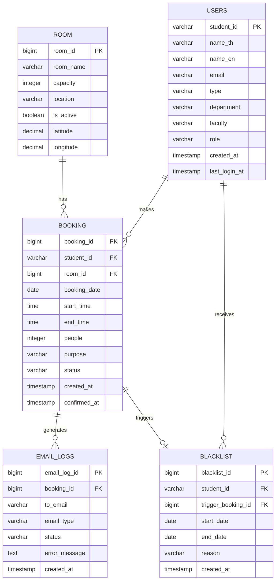

# Database ER Diagram

## Sprint 2 – US8, US9, US10



## Table Descriptions

### USERS

เก็บข้อมูลผู้ใช้งานระบบ

### ROOM

เก็บข้อมูลห้อง โดยเพิ่ม `latitude` และ `longitude` สำหรับตรวจสอบตำแหน่งขณะ Check-in (US8)

### BOOKING

เก็บข้อมูลการจอง โดยใช้ `confirmed_at` สำหรับบันทึกเวลาที่ Check-in สำเร็จ และ `status = 'EXPIRED'` สำหรับรายการ No-show (US8, US9)

### EMAIL_LOGS

เก็บประวัติการส่งอีเมลของระบบ เช่น อีเมลแจ้งเตือน Blacklist

### BLACKLIST

เก็บประวัติการระงับสิทธิ์การจองของผู้ใช้ โดยบันทึกผู้ใช้ Booking ที่เป็นต้นเหตุ วันที่เริ่ม–สิ้นสุด และเหตุผล (US10)

## Relationships

| Relationship | Description |
|---|---|
| USERS 1:N BOOKING | ผู้ใช้หนึ่งคนสามารถจองได้หลายครั้ง |
| ROOM 1:N BOOKING | ห้องหนึ่งห้องมีรายการจองได้หลายรายการ |
| BOOKING 1:N EMAIL_LOGS | รายการจองหนึ่งรายการมีประวัติการส่งอีเมลได้หลายรายการ |
| USERS 1:N BLACKLIST | ผู้ใช้หนึ่งคนมีประวัติ Blacklist ได้หลายรายการ |
```